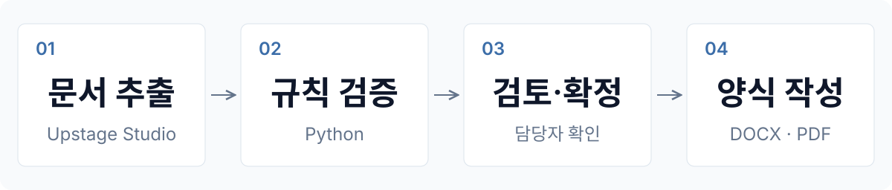

<div align="center">

# Upstage Agent

품의·지출결의 문서 작성 및 검증


[주요 기능](#주요-기능) · [시스템 구조](#시스템-구조) · [빠른 시작](#빠른-시작) · [기술 스택](#기술-스택) · [개발 안내](#개발-안내)

</div>

견적서 검토부터 품의서·지출결의서 작성까지 연결하는 웹 애플리케이션입니다. Upstage Studio의 문서 추출 결과를 코드로 검증하고, 담당자가 확정한 정보를 고정 양식에 반영합니다.

## 주요 기능

| 입력 | 산출물 |
|---|---|
| 견적서 | 물품구매품의서 |
| 품의서 및 거래 증빙 | 지출결의서 |

- 품의: 동일 물품의 견적을 비교하고, 금액·유효기간을 검토해 업체를 선정합니다.
- 결의: 품의 내용과 영수증·카드전표·거래명세서·세금계산서를 대조합니다.
- 업무 연결: 작성한 품의서의 금액·업체·품목과 PDF를 결의 단계로 전달합니다.


견적 검토 예시 — 유효기간이 지난 견적은 담당자의 확인을 거쳐 진행합니다.

<details>
<summary>업로드·업체 선정 화면</summary>


</details>

## 시스템 구조



Studio가 문서를 분류·추출하면 코드가 금액과 업무 규칙을 검증합니다. 확인이 필요한 항목은 담당자가 처리하며, 확정된 정보로 DOCX·PDF를 생성합니다. 결의 입력이 여러 파일이면 PDF 하나로 묶어 Studio에 전달합니다.

- 품의 검증: 단가 × 수량, 합계·부가세, 견적 유효기간, 최저가 동률, 동일 대표자 업체를 확인합니다.
- 결의 검증: 품의·증빙 금액과 지급처 불일치, 초과 집행, 증빙 산술, 사후 품의, 취소·환불 표시를 확인합니다.

금액이 1원이라도 다르면 확인 후보를 표시합니다. 납품·검수·계좌 정보와 서명 등 확인되지 않은 값은 자동 생성하지 않습니다.

## 빠른 시작

### 1. Studio 연결 설정

저장소 루트에서 설정 파일을 복사합니다.

```bash
cp .env.example .env
```

`.env`에 [Upstage API 키](https://console.upstage.ai/api-keys)를 입력합니다. 품의·결의 Agent ID와 Config ID는 Studio의 `API로 이용하기`에서 확인합니다.

```dotenv
UPSTAGE_API_KEY=up_...
PUMUI_AGENT_ID=agt_...
PUMUI_CONFIG_ID=latest
GYEOLUI_AGENT_ID=agt_...
GYEOLUI_CONFIG_ID=latest
```

Agent가 Studio 프로젝트에 속하면 `UPSTAGE_PROJECT_ID`도 설정합니다. API 키는 해당 프로젝트가 있는 조직의 키를 사용합니다. `.env`는 Git에 포함하지 않습니다.

<details>
<summary>워크플로별 설정과 기본값</summary>

| 설정 | 품의 | 결의 |
|---|---|---|
| API 키 | `PUMUI_API_KEY` | `GYEOLUI_API_KEY` |
| Agent ID | `PUMUI_AGENT_ID` | `GYEOLUI_AGENT_ID` |
| Config ID | `PUMUI_CONFIG_ID` | `GYEOLUI_CONFIG_ID` |
| Project ID | `PUMUI_PROJECT_ID` | `GYEOLUI_PROJECT_ID` |

- 개별 API 키를 비우면 `UPSTAGE_API_KEY`, 개별 Project ID를 비우면 `UPSTAGE_PROJECT_ID`를 사용합니다.
- Agent·Config ID를 비우면 [`config/rules.json`](config/rules.json)의 기본값을 사용합니다. `latest`는 최신 Studio 설정을 실행합니다.
- 같은 이름의 환경변수가 있으면 `.env`보다 우선합니다.

</details>

### 2. 앱 실행

Docker Compose로 실행합니다. Python·Chromium과 한글 글꼴은 이미지에 포함됩니다.

```bash
docker compose up -d --build --wait
```

로컬 실행에는 Python 3.11 이상이 필요하며, PDF 생성에는 Chrome 또는 Chromium을 사용합니다.

```bash
./run.sh
```

Windows에서는 `run.bat`을 실행합니다. 앱 주소는 [http://127.0.0.1:8766](http://127.0.0.1:8766)입니다.

### 3. 예시 문서로 시작

- 품의: [`data_team/견적서예시/`](data_team/견적서예시/)의 견적서를 올립니다.
- 결의: [`data_team/결의묶음예시/`](data_team/결의묶음예시/)의 품의서·증빙 묶음을 올립니다.
- 추가 증빙: [`data_team/거래명세서/`](data_team/거래명세서/)에서 확인합니다.

문서를 업로드하고 확인 사항을 처리한 뒤, 생성된 DOCX·PDF를 내려받습니다.

## 운영 및 데이터 관리

- 작업 수명: 업로드 파일, 입력 값, 분석 결과와 생성 문서는 현재 페이지의 임시 작업 공간에만 유지합니다. 품의·결의 메뉴 간 이동 시 작업은 유지되며, 새로고침·재접속 시 초기화됩니다.
- 파일 정리: 페이지 종료 시 임시 파일을 삭제합니다. 종료 알림이 없으면 마지막 요청·연결 확인 후 2분이 지나면 정리합니다. 처리 중인 요청은 완료 후 정리합니다.
- 저장 위치: Docker에서는 `/tmp`의 RAM 파일시스템을 사용합니다. 필요한 문서는 페이지를 닫기 전에 내려받으세요.
- 출력 형식: 웹 화면은 고정 DOCX 양식을 사용합니다. PDF는 DOCX를 HTML로 변환한 뒤 브라우저로 생성하므로 Word 원본과 배치가 다를 수 있습니다.

## 기술 스택

| 영역 | 기술 |
|---|---|
| 문서 인식·추출 | Upstage Studio — Document Parse, Classify, Information Extract |
| 판단·초안 | Solar Pro 4 — Studio Instruct |
| 백엔드 | Python 3.11+ · 표준 라이브러리 HTTP 서버 |
| 프론트엔드 | HTML · CSS · JavaScript ES modules |
| 문서 처리 | `lxml` · `pypdf` · Chrome/Chromium |
| 작업 상태 | 메모리 · 페이지별 임시 파일 |
| 실행·배포 | Docker Compose |

## 개발 안내

| 경로 | 내용 |
|---|---|
| [`app/`](app/) | 업무 규칙, 서비스, 외부 연동, 웹·CLI |
| [`ui/`](ui/) | 품의·결의 화면 |
| [`config/`](config/) | 검증 규칙, 화면 문구, 양식 필드 설정 |
| [`forms/`](forms/) | 품의·결의 양식 |
| [`workflow/`](workflow/) | Studio 품의 워크플로 설정 |
| [`tools/`](tools/) | 서버·검증·배치 실행 명령 |

설계와 세부 규칙은 [품의 설계](docs/DESIGN.md), [결의 설계](docs/GYEOLUI.md), [지출결의서 양식 안내](forms/expense/README.md)를 참고하세요.

<details>
<summary>개발 환경과 검사</summary>

```bash
python3 -m venv .venv
.venv/bin/python -m pip install -r requirements-dev.txt
.venv/bin/python -m pytest -q
.venv/bin/ruff check app tests tools
```

`run.sh`·`run.bat`은 `.venv`가 있으면 해당 Python을 사용합니다. 테스트는 임시 작업 폴더와 모의 Studio 응답을 사용하며 실제 문서를 API로 제출하지 않습니다. HTTP 테스트에는 로컬 포트 사용 권한이 필요하고, 화면 모듈 테스트에는 Node.js가 필요합니다.

</details>

<details>
<summary>명령줄 실행</summary>

아래 Studio 실행 명령은 API 키와 연결 설정이 필요합니다.

```bash
# 구매 건 단위 판정과 정답지 대조
python tools/run_set.py data_team/견적서예시/*.pdf --no-form

# Studio에 가져올 품의 판정 워크플로 설정 생성
python tools/make_set_workflow.py

# 결의 Studio 워크플로 실행
python tools/run_api.py data_team/결의묶음예시 --kind gyeolui --out results_gyeolui_upload

# 저장된 결과로 검증 질문 확인
python tools/gyeolui.py examples/gyeolui/09_맛누리케터링_결의묶음.json --ask

# 같은 물품 묶기 채점
python tools/grouping.py results_team --check
```

CLI 명령이 명시적으로 저장한 파일은 웹 페이지의 임시 작업 수명과 별개입니다.

</details>

<details>
<summary>Docker 운영</summary>

```bash
docker compose logs -f app                  # 로그 확인
docker compose down                         # 종료
docker compose up -d --force-recreate        # .env 변경 반영
APP_DOCKER_PORT=8767 docker compose up -d     # 호스트 포트 변경
```

`.env`는 이미지에 넣지 않고 환경변수로 전달합니다. Docker와 로컬 실행의 기본 포트가 같으므로 동시에 실행하려면 포트를 변경하세요.

</details>

## 팀

대울경 × Upstage AI Agent 해커톤 V.2 출품작입니다. [품의 Agent](https://github.com/yoonhoc/pumui-agent)를 기반으로 품의·결의 업무를 통합했습니다.

| 이름 | 역할 |
|---|---|
| 서수빈 | 기획 |
| 김재현 | 데이터 |
| 최윤호 | 품의 Agent |
| 우용재 | 결의 Agent |
