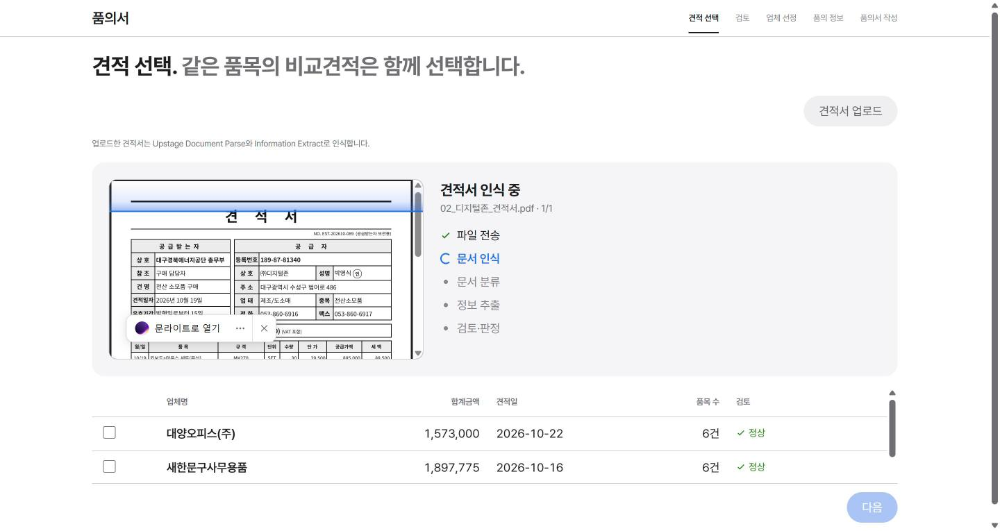
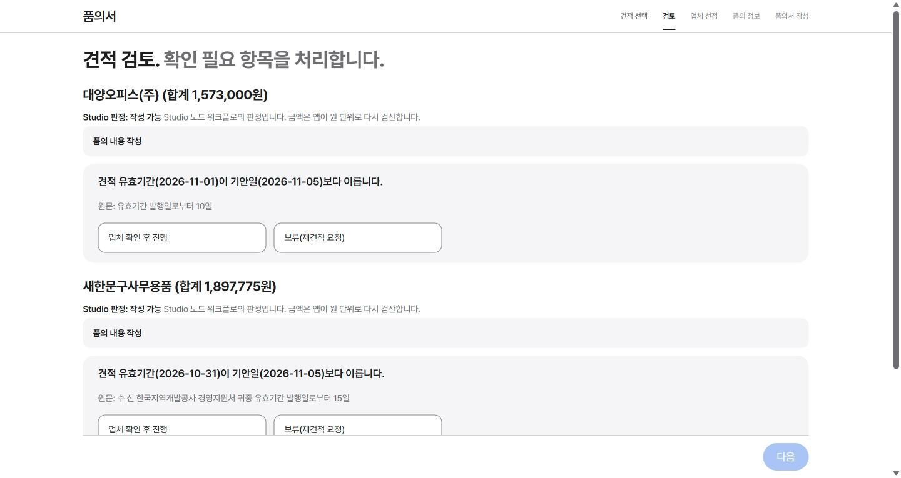
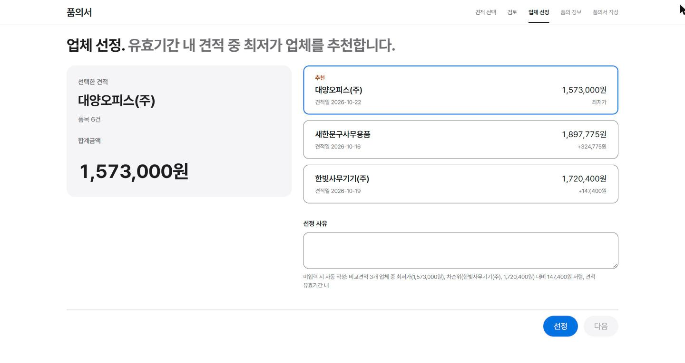
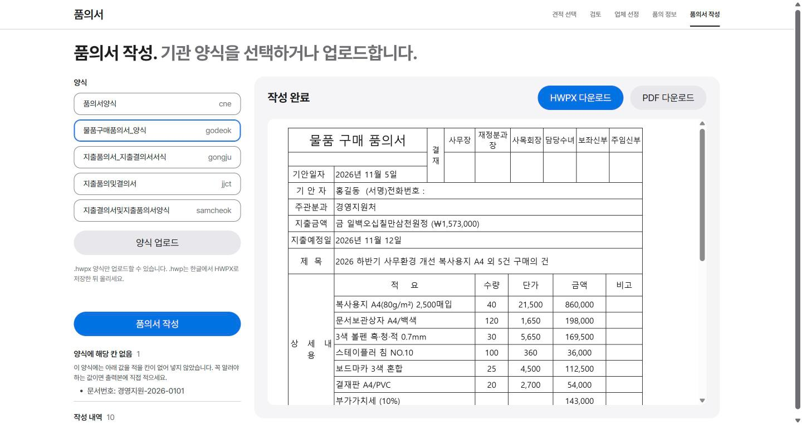

# Upstage Agent — 품의·결의

**견적서로 품의서를, 품의서와 영수증으로 지출결의서를 만드는 AI 에이전트**

문서는 Upstage Studio가 읽고, 금액 계산과 규칙 검사는 코드가 하고, 사람은 정해야 할 것만 고릅니다. 결과는 기관 양식(HWPX)에 그대로 채워 HWPX·PDF로 내려받습니다.


대울경 × Upstage AI Agent 해커톤 V.2 출품작. [품의 Agent](https://github.com/yoonhoc/pumui-agent)에 결의 Agent를 같은 구조로 더해 한 화면에서 이어 씁니다.

---

## 하는 일

화면 위쪽의 **품의 | 결의** 전환으로 두 업무를 오갑니다.

### 품의 — 견적서 → 품의서

| 견적서 업로드 | 검토 |
|---|---|
|  |  |
| 여러 장을 한꺼번에 올리면 동시에 읽고, 같은 물품끼리 자동으로 묶습니다. | 단가×수량, 합계, 부가세를 원 단위로 다시 계산하고, 사람이 정할 것만 묻습니다. |

| 업체 선정 | 품의서 작성 |
|---|---|
|  |  |
| 유효기간 안의 최저가 업체를 추천하고 선정 사유를 씁니다. | 기관 양식의 칸을 찾아 채웁니다. |

### 결의 — 품의서 + 증빙 → 지출결의서

| 단계 | 하는 일 |
|---|---|
| **증빙 선택** | 품의서, 영수증·카드전표·거래명세서·세금계산서(+ 회사 결제 규정, 결의서 양식)를 한 번에 올립니다. 여러 파일은 PDF 하나로 묶어 보냅니다. |
| **검증** | 품의 금액·업체와 실제 증빙을 대조합니다. 금액이 1원이라도 다르면 후보를 보여 주고 담당자가 고릅니다. |
| **결의 정보** | 계정과목·적요·지급방법은 Studio 초안으로 미리 채우고, 결의일·기안자는 담당자가 넣습니다. |
| **결의서 작성** | 품의서와 같은 엔진으로 지출결의서 양식을 채웁니다. |

검증 단계에서 코드가 확인하는 것:

- 지급금액 불일치 (품의서 · 카드전표 · 거래명세서)
- 품의 금액 초과 집행
- 지급처 불일치 (㈜·띄어쓰기 무시)
- 증빙 산술 (공급가액 + 부가세 = 합계, 품목 합 = 공급가액)
- 품의일보다 앞선 거래일 (사후 품의)
- 취소·환불 표시

**품의에서 결의로 이어 쓰기:** 품의서를 만들면 그 금액·업체·품목과 품의서 PDF가 결의 쪽으로 넘어갑니다. 결의에서는 영수증만 올리면 됩니다.

---

## 빠른 시작

### 1. API 키

```bash
cp .env.example .env
```

`.env`에 [Upstage Console](https://console.upstage.ai)의 키를 넣습니다. `.env`는 GitHub에 올라가지 않습니다.

| 변수 | 설명 |
|---|---|
| `UPSTAGE_API_KEY` | 품의 워크플로가 있는 조직의 키 (필수) |
| `GYEOLUI_API_KEY` | 결의 워크플로가 다른 조직에 있을 때만. 비우면 `UPSTAGE_API_KEY`를 씁니다. |

### 2. 실행

**Docker** (Python·Chrome 설치 불필요)

```bash
docker compose up -d --build --wait
```

**로컬** (Python 3.11 이상)

```bash
./run.sh        # Windows는 run.bat 더블클릭
```

브라우저에서 **http://127.0.0.1:8766** 을 엽니다.

### 3. 시험용 문서

| 폴더 | 내용 |
|---|---|
| `data_team/견적서예시/` | 품의용 견적서 PDF |
| `data_team/거래명세서/` | 결의용 영수증·거래명세서 PDF |
| `data_team/결의묶음예시/` | 품의서 + 증빙 + 양식을 한 파일로 묶은 결의 예시 |

---

## 동작 구조

```
[품의]  견적서 ──▶ Studio 품의 워크플로 ──▶ 검산·질문 ──▶ 업체 선정 ──▶ 품의서 HWPX·PDF
                                                                        │
                                                         품의 값 + 품의서 PDF
                                                                        ▼
[결의]  품의서 + 영수증 ──▶ Studio 결의 워크플로 ──▶ 금액·지급처 대조 ──▶ 결의 정보 ──▶ 결의서 HWPX·PDF
```

| Studio 워크플로 | 노드 |
|---|---|
| 품의 | 문서 인식 → 견적서 분류 → 정보 추출 → 견적 검토 → 후속 처리 판정 |
| 결의 | 문서 인식 → 분류·분할 → 추출(품의서/영수증/양식) → 품의서·영수증 비교 → 판정 → 회사 규정 검증 → 판정 → 결의서 기입 데이터 |

설계 원칙: **모델은 읽기만, 계산과 규칙은 코드가, 애매한 건 사람이.** 규칙·문구·양식 칸 이름은 모두 [`config/`](config/)에 있고 코드에 하드코딩하지 않습니다.

---

## 폴더 구조

```
upstage_agent/
├── tools/           서버, Studio API 호출, 검산·질문, 업체 선정, 양식 채우기
│   └── gyeolui.py   결의: 결과 읽기, 대조·질문, 결의서 입력값
├── ui/              화면 (app.js 품의·공용, gyeolui.js 결의)
├── config/          규칙, 화면·질문 문구, 양식 칸 사전
├── forms/           기관 양식 (forms/expense: 기본 지출결의서)
├── workflow/        Studio 품의 워크플로 설정
├── data_team/       팀 예시 문서 (results_team: Studio 결과, answers_team: 정답지)
├── examples/        예시 입력·결과
├── docs/            설계 기록
└── Dockerfile, compose.yaml, run.sh, run.bat
```

올린 파일과 결과는 `data_upload/`, `results_upload/`, `results_gyeolui_upload/`, `out/`에 쌓이며 GitHub에는 올라가지 않습니다.

---

## 기술 스택

| 영역 | 사용 |
|---|---|
| 문서 인식·추출 | Upstage Studio (Document Parse, Classify, Information Extract) |
| 판단·문장 | Solar Pro 4 (Studio Instruct) |
| 서버 | Python 표준 라이브러리 HTTP 서버 |
| 양식 | HWPX 직접 편집 (lxml), PDF 미리보기 (Chrome/Chromium) |
| 화면 | HTML · CSS · JavaScript (프레임워크 없음) |
| 배포 | Docker Compose (Chromium·한글 글꼴 포함) |

---

## 더 보기

- [품의 설계](docs/DESIGN.md) — 검산 규칙, 질문 방식, 양식 채우기 원리, 시험 결과
- [결의 설계](docs/GYEOLUI.md) — 결의 결과 읽기, 대조 규칙, 품의 연결, 결의서 채우기

<details>
<summary>명령줄로 쓰기</summary>

```bash
# Studio 워크플로만 실행
python tools/run_api.py data_team/견적서예시 --out results_team --skip-existing
python tools/run_api.py data_team/결의묶음예시 --kind gyeolui --out results_gyeolui_upload

# 터미널에서 검증 질문에 답하기
python tools/gyeolui.py examples/gyeolui/09_맛누리케터링_결의묶음.json --ask

# 같은 물품 묶기 채점
python tools/grouping.py results_team --check
```
</details>

<details>
<summary>Docker 운영</summary>

```bash
docker compose logs -f app                  # 로그
docker compose down                         # 끄기
docker compose up -d --force-recreate       # .env 바꾼 뒤
APP_DOCKER_PORT=8767 docker compose up -d   # 포트 바꾸기
```

- `.env`는 이미지에 넣지 않고 읽기 전용으로 붙입니다.
- 올린 파일·결과·만든 문서는 호스트 폴더에 남습니다.
- `run.sh`와 같은 폴더·포트(8766)를 쓰므로 둘을 동시에 켜지 마세요.
</details>

---

## 팀

| 이름 | 맡은 일 |
|---|---|
| 서수빈 | 기획 |
| 김재현 | 데이터 |
| 최윤호 | 품의 Agent |
| 우용재 | 결의 Agent |
