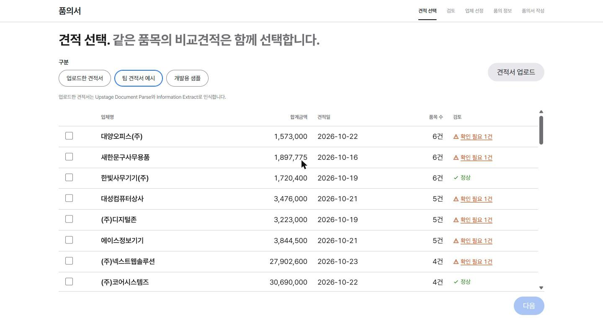

# 품의·결의 Agent

**제각각인 견적서를 올리면 품의서를, 품의서와 영수증·거래명세서를 올리면 지출결의서를 — 검산하고, 사람이 정할 것만 묻고, 기관 양식 그대로 채워 주는 AI 에이전트**

대울경 × Upstage AI Agent 해커톤 V.2 출품작. [품의 Agent](https://github.com/yoonhoc/pumui-agent)를 바탕으로 결의(지출결의서) 워크플로를 같은 구조로 더했습니다.


## 왜 만들었나

물품을 사려면 업체 견적서 여러 장을 받아 비교하고, 금액을 검산하고, 기관마다 다른 품의서 양식에 옮겨 적어야 합니다.
견적서는 업체마다 표, 손글씨, 스캔본, 엑셀, 팩스처럼 양식이 제각각이라 이 일이 생각보다 오래 걸립니다.
품의 Agent는 읽기와 계산, 양식 채우기를 맡고, 사람은 결정만 하도록 만들었습니다.

## 주요 기능

| 견적 선택 | 검토 |
|---|---|
|  |  |
| 견적서 PDF를 올리면 Upstage Studio가 업체·품목·금액을 읽습니다. | 단가×수량, 합계, 부가세를 원 단위로 다시 계산하고, 사람이 정해야 할 것만 선택지와 함께 묻습니다. |

| 업체 선정 | 품의서 작성 |
|---|---|
|  |  |
| 유효기간 안의 견적 중 최저가 업체를 추천하고 선정 사유를 써 줍니다. | 기관 양식(HWPX)의 칸을 찾아 그대로 채우고, HWPX와 PDF로 내려받습니다. |

## 결의 기능 (이 저장소에서 더한 것)

품의 화면은 그대로 두고, 상단의 **품의 | 결의** 전환으로 결의 단계를 씁니다.

| 단계 | 하는 일 |
|---|---|
| 증빙 선택 | 품의서, 영수증·카드전표·거래명세서·세금계산서, (회사 결제 규정), (지출결의서 양식)을 한 번에 올립니다. 여러 파일은 PDF 하나로 묶어 Studio 결의 워크플로에 보냅니다. 몇 분 걸리는 실행은 서버가 뒤에서 돌리고 화면은 진행 상황만 확인합니다. |
| 검증 | 품의 금액·업체와 실제 증빙을 표로 대조합니다. 금액이 하나로 모이지 않으면(1원이라도) 후보를 보여 주고 담당자가 고릅니다. 증빙 산술(공급가액+부가세=합계, 품목 합=공급가액), 지급처 불일치, 품의보다 앞선 거래일(사후 품의), 취소 표시, 품의 초과 집행을 코드로 검사합니다. Studio의 비교 보고서·판정·규정 검토는 함께 보여 줍니다. |
| 결의 정보 | 계정과목·적요·지급방법·증빙 첨부는 Studio 기입 데이터로 미리 채우고, 결의일·기안자는 담당자가 정합니다(품의서 작성자·거래일을 그대로 옮기지 않습니다). 칸마다 Studio의 근거 설명을 보여 줍니다. |
| 결의서 작성 | 품의서와 같은 양식 채우기 엔진으로 지출결의서 양식(HWPX)을 채우고 HWPX·PDF로 내려받습니다. 기본 양식(`forms/expense/`)과 기관 양식 중 결의서가 든 것(공주·제주·삼척)을 고를 수 있습니다. |

**품의 → 결의 연결:** 품의서 작성 단계에서 품의서를 만들면 그 품의 값(업체·금액·품목)과 품의서 PDF가 결의 쪽으로 넘어갑니다. 결의 증빙 선택에서 "작성한 품의서 PDF를 묶음 맨 앞에 넣기"를 켜면 영수증만 올려도 되고, 검증 단계는 작성한 품의서를 비교 기준으로 씁니다.

## 빠른 시작

**Windows:** `run.bat`을 더블클릭합니다.
**macOS / Linux:** 터미널에서 `./run.sh`를 실행합니다.

처음 실행하면 필요한 패키지를 설치하고 브라우저에서 http://127.0.0.1:8766 를 엽니다(품의 전용 앱 8765와 같이 켤 수 있게 포트를 나눴습니다). 끄려면 창에서 `Ctrl+C`를 누릅니다.

```bash
cd gyeolui-agent
./run.sh        # Windows는 run.bat
```

> **API 키가 필요합니다.** 처음 실행하면 `.env` 파일이 만들어집니다. `UPSTAGE_API_KEY=` 뒤에 **팀 조직** Upstage 키를 넣고 다시 실행하세요. 결의 워크플로가 다른 조직에 있으면 `GYEOLUI_API_KEY=`에 그 조직 키를 넣습니다(비우면 `UPSTAGE_API_KEY`를 씁니다). `.env`는 GitHub에 올리지 않습니다.
>
> 화면이 열리면 **견적서 업로드**로 견적서 PDF(여러 장 가능)를 올립니다. 시험해 볼 견적서는 `data_team/견적서예시/`, 결의 증빙은 `data_team/거래명세서/`(영수증·거래명세서)와 `data_team/결의묶음예시/`(품의서+증빙+양식 묶음)에 있습니다.

### Docker로 실행

Docker Desktop(또는 Docker Engine + Compose)이 있으면 Python·Chrome 설치 없이 실행할 수 있습니다. 이미지에 Chromium과 한글 글꼴이 들어 있어 품의서·결의서 PDF도 만듭니다.

```bash
docker compose up -d --build --wait     # http://127.0.0.1:8766
docker compose logs -f app              # 로그
docker compose down                     # 끄기
```

- `.env`는 이미지에 넣지 않고 읽기 전용으로 붙입니다. 먼저 `.env`를 만들어 두세요(`cp .env.example .env` 후 키 입력). 키를 바꾼 뒤에는 `docker compose up -d --force-recreate`.
- 올린 견적서·증빙(`data_upload/`), Studio 결과(`results_upload/`, `results_gyeolui_upload/`), 올린 양식(`forms/uploads/`), 만든 문서(`out/`)는 호스트 폴더에 그대로 남습니다. `run.sh`로 켠 앱과 같은 폴더를 쓰므로 둘을 동시에 켜지 마세요(포트도 같은 8766).
- 호스트의 `127.0.0.1`에만 엽니다. 포트를 바꾸려면 `APP_DOCKER_PORT=8767 docker compose up -d`.
- 코드를 고친 뒤에는 `docker compose up -d --build --wait`.

## 동작 구조

```
[품의] 견적서 PDF 업로드
   │
   ▼
Upstage Studio 품의 워크플로 ─ 업로드할 때만 실행
   문서 인식 → 분류(견적서인지) → 정보 추출 → 견적 검토 → 후속 처리 판정 → 품의 문장
   │
   ▼
Python 코드 ─ 원 단위 검산·질문 → 업체 추천 → 기관 양식(HWPX) 채우기 → PDF ──┐
                                                                       │ 품의 값·품의서 PDF
[결의] 품의서 + 영수증·거래명세서 (+ 규정, + 양식) 업로드  ◀────────────────┘
   │  여러 파일 → PDF 한 묶음
   ▼
Upstage Studio 결의 워크플로 ─ 백그라운드 실행, 화면은 진행 확인
   문서 인식 → 분류·분할 → 추출(품의서/영수증/양식) → 품의서·영수증 비교 → 판정
   → 회사 규정 검증 → 판정 → 지출결의서 기입 데이터
   │
   ▼
Python 코드 ─ 금액·지급처 대조·질문 → 결의 정보 → 결의서 양식(HWPX) 채우기 → PDF
```

- **모델은 읽기만, 계산과 규칙은 코드가, 애매한 건 사람이** 정합니다.
- 품의 Studio 워크플로 설정의 원본은 [`workflow/품의 Agent (노드).json`](workflow/) 입니다. 결의 워크플로 ID·노드 이름은 `config/rules.json`의 `runtime.gyeolui_studio`에 있습니다.
- 규칙, 화면 문구, 양식 칸 이름은 모두 [`config/`](config/)에 있고 코드에 하드코딩하지 않습니다.
- 올린 견적서는 `data_upload/`, Studio 결과는 `results_upload/`에 쌓입니다. 결의 증빙 묶음은 `data_upload/gyeolui/`, 결의 결과는 `results_gyeolui_upload/`에 쌓입니다(GitHub에는 올라가지 않습니다).

## 기술 스택

| 영역 | 사용 |
|---|---|
| 문서 인식·추출 | Upstage Studio (Document Parse, Classify, Information Extract) |
| 판단·문장 | Solar Pro 4 (Studio Instruct 노드) |
| 서버 | Python 표준 라이브러리 HTTP 서버 |
| 양식 | HWPX 직접 편집(lxml), PDF 미리보기(Edge/Chrome) |
| 화면 | HTML · CSS · JavaScript (프레임워크 없음) |

## 폴더 구조

```
pumui-agent/
├── run.bat, run.sh     실행
├── tools/              서버, 검산·질문(harness), 업체 선정, 양식 채우기, Studio API 호출
│   └── gyeolui.py      결의: Studio 결과 읽기, 금액·지급처 대조·질문, 결의서 입력값
├── ui/                 화면 (app.js 품의 + 공용, gyeolui.js 결의)
├── config/             규칙, 화면 문구, 질문 문구, 양식 칸 이름
│                       (결의: rules.json gyeolui·runtime.gyeolui_studio, gyeolui_fields.json, form_roles_gyeolui.json)
├── workflow/           Upstage Studio 워크플로 설정
├── forms/, templates/  기관 품의서·결의서 양식 (forms/expense: 기본 지출결의서)
├── data_team/          팀 견적서·영수증·결의 묶음 예시 PDF  (results_team/: Studio 결과, answers_team/: 정답지)
├── examples/gyeolui/   결의 워크플로 실제 결과 예시
└── docs/               설계 기록, 화면 캡처
```

## 팀

| 이름 | 맡은 일 |
|---|---|
| 서수빈 | 기획 |
| 김재현 | 데이터 |
| 최윤호 | 품의 Agent |
| 우용재 | 결의 Agent |

품의서가 승인되고 실제 거래가 끝나면, 결의 Agent가 거래명세서·영수증을 품의서와 맞춰 지출결의서를 만듭니다. 이 저장소는 두 Agent를 한 화면에서 이어 씁니다.

## 더 보기

- [설계 기록](docs/DESIGN.md): 검산 규칙, 질문 방식, 양식 채우기 원리, Studio 워크플로 구성, 시험 결과
- [결의 설계](docs/GYEOLUI.md): 결의 워크플로 결과 읽기, 대조 규칙, 품의 연결, 결의서 양식 채우기

### 명령줄

```bash
python tools/run_api.py data_team/결의묶음예시 --kind gyeolui --out results_gyeolui_upload   # 결의 워크플로만 실행
python tools/gyeolui.py examples/gyeolui/09_맛누리케터링_결의묶음.json --ask                # 터미널에서 검증 질문에 답하기
```
